# Báo cáo bài test: Sandloop

Ngày: 04/11/2026. Game: Sand Loop (three.js + TypeScript + Vite), thư mục `Sandloop-goi-test/`.

Báo cáo trả lời ba câu hỏi của đề bài:

1. Chơi và kiểm thử game được gửi, tìm ra các vấn đề của game và cải thiện.
2. Xây dựng tool xếp level cho game.
3. Phân tích số liệu và đưa ra vấn đề, kèm tool tương ứng.

## Tóm tắt

| Câu | Kết quả | Sản phẩm |
|---|---|---|
| 1. Test và cải thiện | Tìm **39 vấn đề** (4 P1, 18 P2, 17 P3). Đã sửa hầu hết; 2 mục bỏ qua có chủ ý, vài mục mới làm một phần. Thêm nội dung mới: menu, tim, booster, 4 cơ chế, 5 màn (11 đến 15). | `Danh-sach-van-de-Sandloop-v4.xlsx`, `qa/BAO-CAO-KIEM-THU.md`, `dist/index.html` |
| 2. Tool xếp level | `designer.html`: dựng, chỉnh, tự sinh bố cục xô theo độ khó Dễ / Khó / Siêu khó, tự giải, đo độ khó, xuất về game. Tự sinh khớp độ khó tốt với Dễ và Khó, **yếu với Siêu khó**. | `designer.html`, `src/designer/*` |
| 3. Phân tích số liệu | `analytics.html`: tự phát hiện vấn đề từ số liệu, biểu đồ, mô phỏng hành trình người chơi. Phát hiện chính: **vách độ khó ở màn 7 đến 10** (bản bot đo được 0 đến 13% thắng với 3/4 nhóm người chơi), 0% người chơi ảo tới màn cuối. | `analytics.html`, `src/analytics/*` |

**Lưu ý trung thực về số liệu.** Mọi số ở câu 3 đến từ **bot mô phỏng chạy trên lõi game thật**, không phải người chơi thật. Bot là heuristic nên chỉ dùng để thấy xu hướng và tìm chỗ nghi ngờ, không dùng để kết luận chắc chắn về hành vi người thật. Phần hành vi tim, quảng cáo, bỏ chơi là giả định chỉnh được. Quảng cáo trong game chỉ là giả lập.

---

# Câu 1. Chơi, kiểm thử, tìm vấn đề và cải thiện

## 1.1 Cách làm

- Build và chạy bản `dist/index.html` (mở file trực tiếp và qua HTTP), điều khiển bằng chuột thật trong trình duyệt có cửa sổ, đo ở nhiều kích thước màn hình (390×844, 360×640, 844×390, 1366×768, 1920×1080).
- Dựng điều kiện biên bằng cách gọi trạng thái nội bộ (save hỏng, reload giữa lúc thắng, Marks bật/tắt).
- 300 lượt mô phỏng bằng bot: 10 seed × 10 màn × 3 chính sách chọn xô; 8 kiểm tra luật chuyên biệt (bấm xô bị chặn, tràn sức chứa, xô `?`, lớp chặn 4 hạt, thắng/thua đúng một lần...). Cả 8 đều đạt.
- Đọc mã nguồn cho các lỗi khó tái hiện (âm thanh, haptics).
- Đối chiếu với game gốc tham chiếu `sand-storm-2` để lấy ý tưởng sửa và để kiểm tra lỗi có phải do thiết kế.
- Người chơi (người dùng) tự chơi cả 10 màn gốc: cả 10 đều thắng được; lỗi "thắng xong mất thưởng" cũng được tự tái hiện.

Báo cáo kiểm thử chi tiết (tái hiện, số đo, nguồn mã, hướng sửa): `qa/BAO-CAO-KIEM-THU.md`. Danh sách đầy đủ có cột Lý do và Hướng sửa: `Danh-sach-van-de-Sandloop-v4.xlsx` (sheet "Vấn đề", 39 dòng; sheet "Vấn đề sand-storm-2" 31 dòng và sheet "Đối chiếu 2 dự án" để so sánh).

## 1.2 Vấn đề quan trọng nhất

### P1: mất dữ liệu, hỏng hiển thị, độ khó

| # | Vấn đề | Bằng chứng đo | Cách xử lý |
|---|---|---|---|
| 1 | Thắng xong có thể mất thưởng và mở khóa màn | Thắng màn 1, reload trong khoảng chờ 1,6 s: trước/sau `wins=1, coins=0, unlocked=1`; lần thắng sau chỉ tính "chơi lại" (+5 xu) nên màn 2 không tự mở | Ghi kết quả, thưởng, mở khóa một lần ngay khi thắng (`finishLevel`); màn kết quả chỉ để hiển thị |
| 2 | Hàng xô cuối màn 10 bị cắt ở khổ ngang/desktop | Tọa độ y tâm hàng xô cuối vượt chiều cao màn hình ở 360×640, 844×390, 1366×768 | Camera fit theo số hàng thực của từng màn (`Stage.setBoardRows`) |
| 3 | Rò texture GPU mỗi lần vào màn | Texture tăng `152 → 482` sau 30 lần restart | `dispose()` cho các view/actor, cache texture dùng chung |
| 25 | Vách độ khó màn 4 đến 6: chưa được dạy đã phải lên kế hoạch | Bản gốc: màn 5 nhóm "Phổ thông" thắng 0%, chỉ nhóm "Lập kế hoạch" 100% | Xếp lại xô màn 4 đến 6, giảm xô `?`, bỏ nhãn HARD ở màn 5, thêm gợi ý một lần |

**Ảnh bằng chứng lỗi (chụp trước khi sửa):**

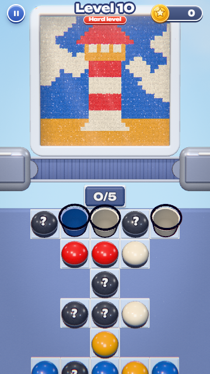
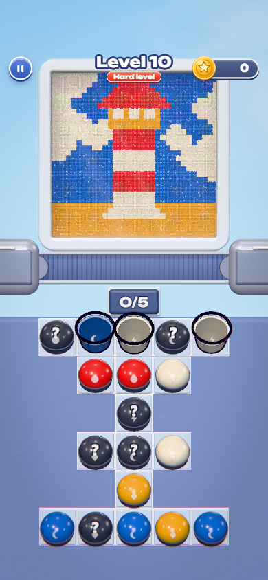

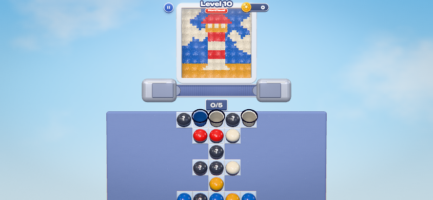

### P2: trải nghiệm và độ đúng đắn (chọn lọc)

- **Thiếu hướng dẫn** (#18): không có tutorial, không giải thích đường thoát, xô `?`, lớp cát chặn. Đã thêm gợi ý một lần (bấm, bị chặn, băng đầy, `?`).
- **Thua là hết** (#27): không hoàn tác, không cứu. Đã thêm Undo 3 bước mỗi ván (mất thưởng "qua ngay lượt đầu").
- **Cảnh báo sắp thua muộn** (#28): chỉ còn khoảng 1 giây. Đã thêm cảnh báo đỏ, thua sau 3,2 s.
- **Restart không tính là một lần thử** (#11): farm được bonus first-try. Đã tính ván bỏ giữa chừng là một lần thử.
- **Marks làm lộ màu xô bí ẩn và không cập nhật xô trên băng chuyền** (#6, #7). Đã sửa cả hai.
- **Levels tràn ngang, Pause chết ở màn thắng/thua, màn thắng thiếu lối chơi lại / về danh sách, trang trắng khi không có WebGL** (#4, #5, #9, #10). Đã sửa.
- **Xô vừa bấm chờ vài giây mới hút, có lúc biến mất** (#26): đã đổi luật băng chuyền, khay bay thẳng xuống ô trống đang nằm trên làn; hàng chờ vẽ rõ.

### P3: chi tiết (chọn lọc)

Haptics phụ thuộc Sound (#21), nhạc vẫn chạy khi tab ẩn và Music OFF còn đường reverb (#22), save hỏng làm game không khởi động (#20, đã thêm sanitize + bản sao `.bak`), nút HUD quá nhỏ (#16, tối thiểu 44 px), thiếu phản hồi khi bấm xô khóa (#17), không lưu ván giữa màn (#31), nút cài đặt thiếu `aria-pressed` (#23).

**Bỏ qua có chủ ý:** #32 (đa ngôn ngữ), #39 (đổi bảng màu). **Làm một phần:** #26, #27 (không thêm ô băng chuyền, để khỏi lệch độ khó), #29 (cột sáng vùng hút, chưa làm mờ cột bị chặn), #23 (chưa có điều khiển xô bằng bàn phím).

## 1.3 Cải thiện thêm (nội dung và vòng chơi)

Ngoài sửa lỗi, game được bổ sung để có vòng lặp chơi dài hơi:

- **Main menu dạng đường đi qua các màn**, nút Home trong Pause / Thắng / Thua.
- **Tim** (tối đa 5, hồi 20 phút/tim, mất tim khi thua rồi rời màn hoặc rời giữa màn), **xu**, **quà ngày 7 ngày**, **cửa hàng** (tim và booster).
- **3 booster**: Hand Pick (màn 5), Sand Pull (màn 8), Shuffle (màn 11), 100 đến 150 xu.
- **4 cơ chế mới** lấy từ `sand-storm-2`: hầm, xô đóng băng, thanh chắn, chìa/khóa; **màn 11 đến 15** cùng 5 tranh mới (tổng 15 màn). Mô tả và chỗ khác với bản gốc: `gd/CO-CHE-MOI.md`.
- **Chặng cuối x3**: còn 5 xô cuối thì cả màn tự chạy x3 để bớt thời gian chờ.
- **Tài liệu kinh tế sink - source**: `gd/ECONOMY-SINK-SOURCE.md`.

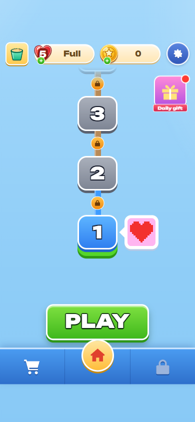
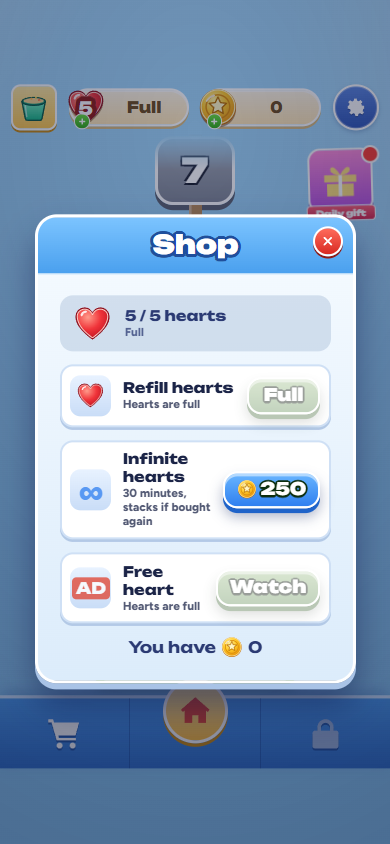
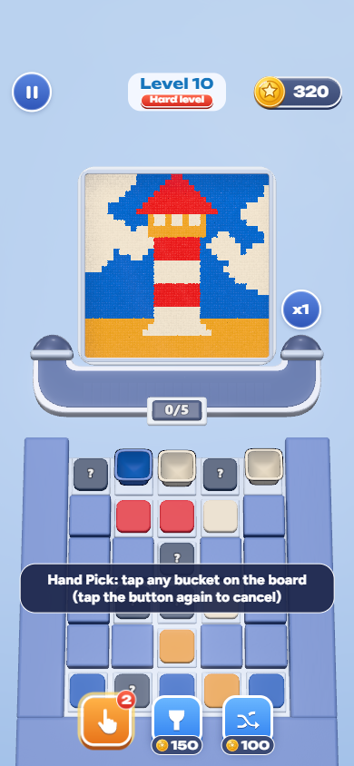
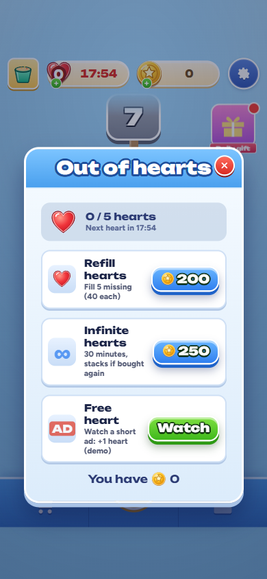

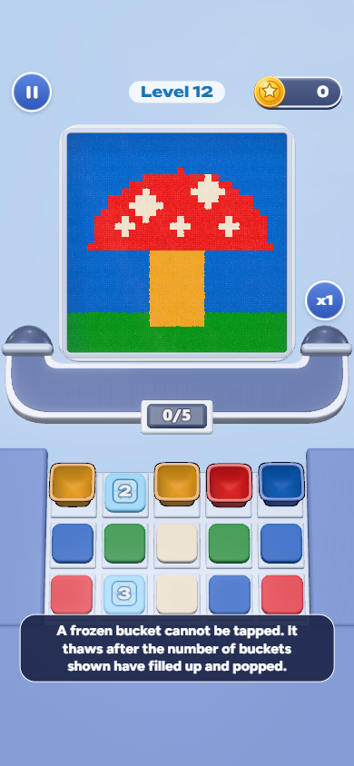
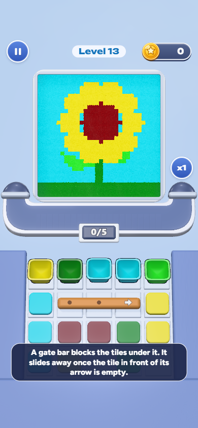
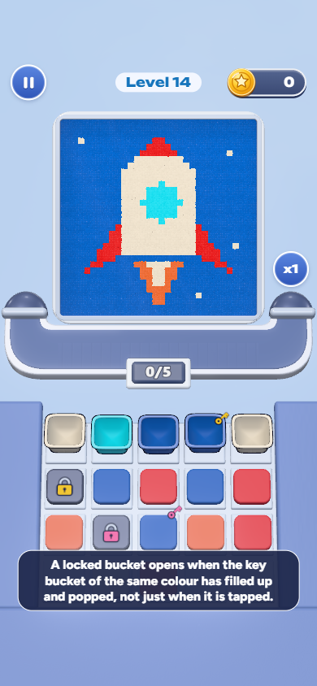
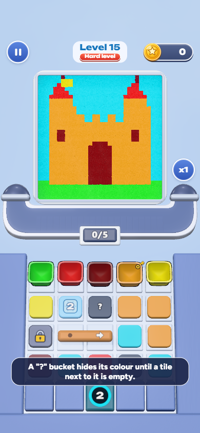

## 1.4 Còn tồn tại

- Màn 7 đến 10 vẫn rất khó với bot (xem câu 3); chưa chỉnh vì cần chơi thử với người thật.
- Chưa test trên thiết bị cảm ứng thật, Safari/Firefox, âm thanh và rung trên phần cứng.
- Thưởng xu vẫn ít nơi tiêu (xem câu 3, mục 3.5).

---

# Câu 2. Tool xếp level: Sandloop Level Designer

## 2.1 Mục tiêu

Cho designer dựng một màn (tranh cát + bố cục xô) và **biết ngay màn đó khó cỡ nào** thay vì chơi tay: tự sinh bố cục theo độ khó mong muốn, tự giải, đo độ khó, rồi xuất thẳng về game.

Mở: `npm run designer` rồi bấm đúp `dist-designer/designer.html` (một file duy nhất, chạy offline); chế độ dev: `npm run designer:dev`.

## 2.2 Chức năng

| Nhóm | Chi tiết |
|---|---|
| Dựng màn | Thả ảnh vào để tạo tranh pixel (gộp về tối đa N màu theo ý), chỉnh bàn xô bằng công cụ vẽ ô: xô, xô `?`, ô hố, đổi số hàng/cột. Mở lại 15 màn có sẵn để sửa. |
| Gán độ khó | Designer tự chọn tag **Dễ / Khó / Siêu khó**. Tool không tự gán; nút Gen khóa tới khi chọn tag. |
| Sinh tự động | Chia số xô và sức chứa theo lượng cát từng màu, tối ưu bố cục xô bằng simulated annealing, lấp đủ ô sàn (mặc định 100%). Gen dừng ngay khi khớp tag (thời gian chỉ là giới hạn trên); nhiều worker chạy đua. |
| Đo độ khó | Duyệt toàn bộ đồ thị quyết định: số đường thắng, đường kẹt, bẫy nhìn thấy được, xác suất thắng nếu bấm ngẫu nhiên, thế "không còn đường thắng". Hiện **khớp / lệch** so với tag kèm gợi ý khi lệch. |
| Tự giải | Chạy "kiểu người chơi" (bấm tiếp khi còn slot, băng chuyền 5 ô) và **replay xác nhận trên lõi game thật** trước khi báo kết quả. |
| Xuất | Ghi `level-data.ts` và `art-data.ts` về `src/core` qua File System Access (dự phòng: tải file). |

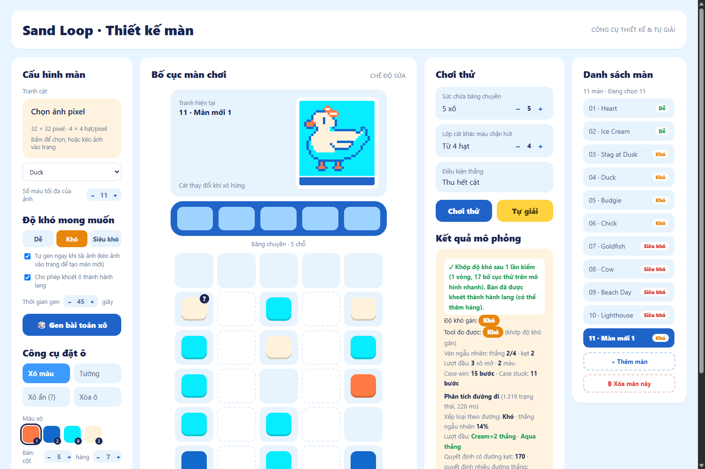

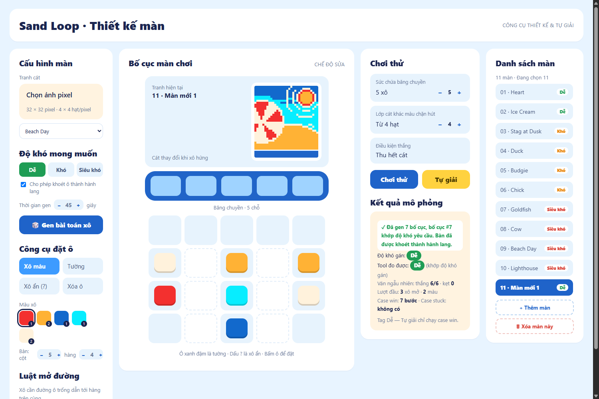

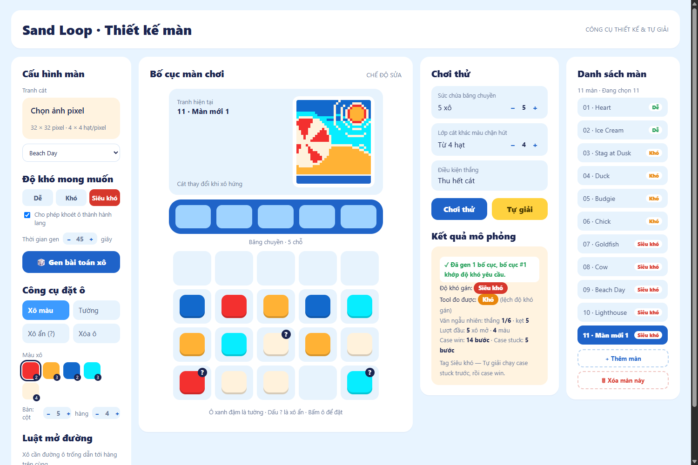

## 2.3 Cách hoạt động

- **Định nghĩa độ khó** (theo đặc tả của designer): *Dễ* = mọi đường đi đều thắng. *Khó* = tối đa 3 đường, đúng 1 đường kẹt nhìn thấy được, người bấm ngẫu nhiên thắng khoảng 15 đến 85%. *Siêu khó* = đúng 1 đường thắng, ít lựa chọn tự do, bấm ngẫu nhiên thắng không quá 10%.
- **Hai tầng mô hình.** Tầng nhanh (`fast.ts`, mô hình "đã lắng": cát theo cột, khoảng 0,05 ms mỗi lần bấm) cho phép duyệt hàng chục nghìn trạng thái và chạy annealing. Tầng thật (`Game`/`SandSim` nguyên bản) kiểm lại top ứng viên và mọi lời giải/kẹt trước khi báo, nên kết quả hiển thị không phụ thuộc mô hình nhanh.
- **Lý do cần cả hai.** Phát hiện chính khi đối chiếu với tool cũ của dự án (WinForms): trên bàn xô thuần túy bấm xô **không bao giờ gây hại** (kết quả không phụ thuộc thứ tự), nên mẫu bố cục tĩnh không thể tạo bẫy. Kẹt chỉ đến từ hạn chế 5 slot và lớp cát khác màu chặn, vì vậy phải mô phỏng cát và băng chuyền mới đo được độ khó.
- **Vòng sinh:** [tối ưu trên mô hình nhanh → kiểm top ứng viên bằng game thật], xen kẽ chế độ khoét hành lang (shape) và bàn tự do.

## 2.4 Kết quả đo

Thử trên 10 tranh, ngân sách 20 giây mỗi tranh, đếm số tranh sinh ra màn **khớp đúng tag**:

| Cấu hình | Dễ | Khó | Siêu khó |
|---|---:|---:|---:|
| Thuật toán gen cũ (baseline) | 4/10 | 6/10 | 2/10 |
| Mới, bật khoét hành lang | **10/10** | 7/10 | 1/10 |
| Mới, bàn tự do (không khoét) | 4/10 | **9/10** | 0/10 |

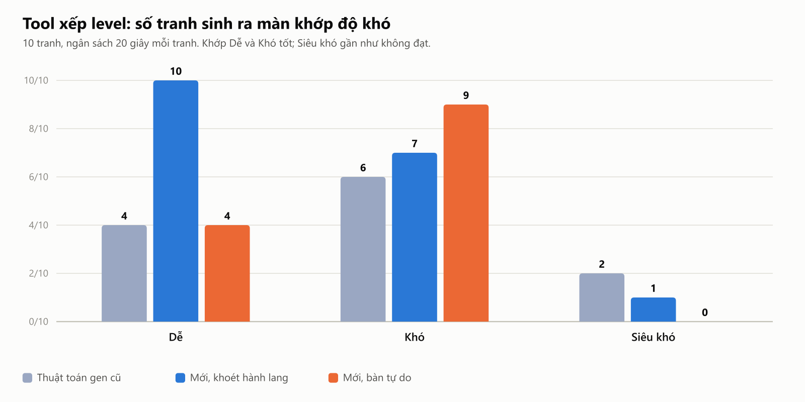

Chọn "bàn tự do" làm mặc định vì designer yêu cầu lấp đủ sàn và các màn khó của game đều đầy 100%.

## 2.5 Giới hạn đã biết

- **Siêu khó gần như không đạt**: chỉ khả thi với tranh phụ thuộc thứ tự màu sâu (ví dụ Beach Day), vì game chỉ có 5 slot. Cần thêm cơ chế (khóa/chìa, đóng băng) hoặc hạ định nghĩa Siêu khó; tool đang báo "lệch" kèm gợi ý thay vì ép.
- Mô hình nhanh bỏ qua cát trượt chéo, nên khoảng 12% lượt bấm bị "illegal" khi replay trên game thật (Beach Day lệch nhiều). Vì vậy lời giải luôn được replay xác nhận.
- Designer **chưa hiểu các token cơ chế mới** (hầm, xô đóng băng, thanh chắn, chìa/khóa): màn 11 đến 15 vẫn dựng bằng script (`qa/mech-search.ts`) rồi đưa vào `level-data.ts`.
- Cần chạy lại `qa/precompute-designer.ts` khi lõi game đổi và `qa/fast-calib.ts` để kiểm tra mô hình nhanh còn khớp.

---

# Câu 3. Phân tích số liệu, đưa ra vấn đề và tool

## 3.1 Nguồn số liệu và tool

| Nguồn | Nội dung | Ghi chú |
|---|---|---|
| `gd/csv/01 đến 04` (bộ số liệu GD cho sẵn) | 10 màn gốc × 4 nhóm kỹ năng (Ngẫu nhiên, Phổ thông, Cẩn thận, Lập kế hoạch); phễu người chơi, bỏ chơi, xu | Do máy mô phỏng, **không phải người thật**; trước khi sửa game |
| `src/analytics/baseline.json` | Bot chạy sẵn trên **bản game hiện tại**: 15 màn × 4 nhóm × 30 lượt | Chạy bằng `qa/precompute-analytics.ts` trên lõi game thật |
| Bot trong trình duyệt | Chạy lại trong Web Worker với persona/cơ cấu nhóm tự chỉnh | Khoảng 0,3 đến 1,2 s mỗi ván |

**Tool:** `analytics.html` (`npm run analytics`, mở `dist-analytics/analytics.html`). 4 tab:

1. **Tổng quan & vấn đề**: KPI và bộ phát hiện vấn đề theo luật (thắng quá thấp/cao, spike độ khó giữa hai màn, nhiều người bỏ chơi, hết tim, lượt đầu hầu như sai...), mỗi vấn đề có mức độ (nghiêm trọng, đáng chú ý, nhẹ), gợi ý sửa, link sang màn; ngưỡng chỉnh được.
2. **Biểu đồ**: đường cong độ khó, heatmap, spike, khoảng cách kỹ năng giữa các nhóm, thua ở đâu, phễu, số lần thử, scatter cấu trúc màn.
3. **Mô phỏng hành trình** kiểu Loopcraft: sơ đồ nút (cài game → chơi → thắng/thua → hết tim → xem quảng cáo / mua tim / chờ → bỏ chơi) và Monte Carlo với 4000 người chơi ảo; chỉnh tim, giá, thưởng, thời gian hồi; ghim kết quả để so sánh.
4. **Bot & nhóm người chơi**: sửa persona và tỉ trọng, chạy bot, nhập CSV của GD, xuất báo cáo `.md` / `.csv`.

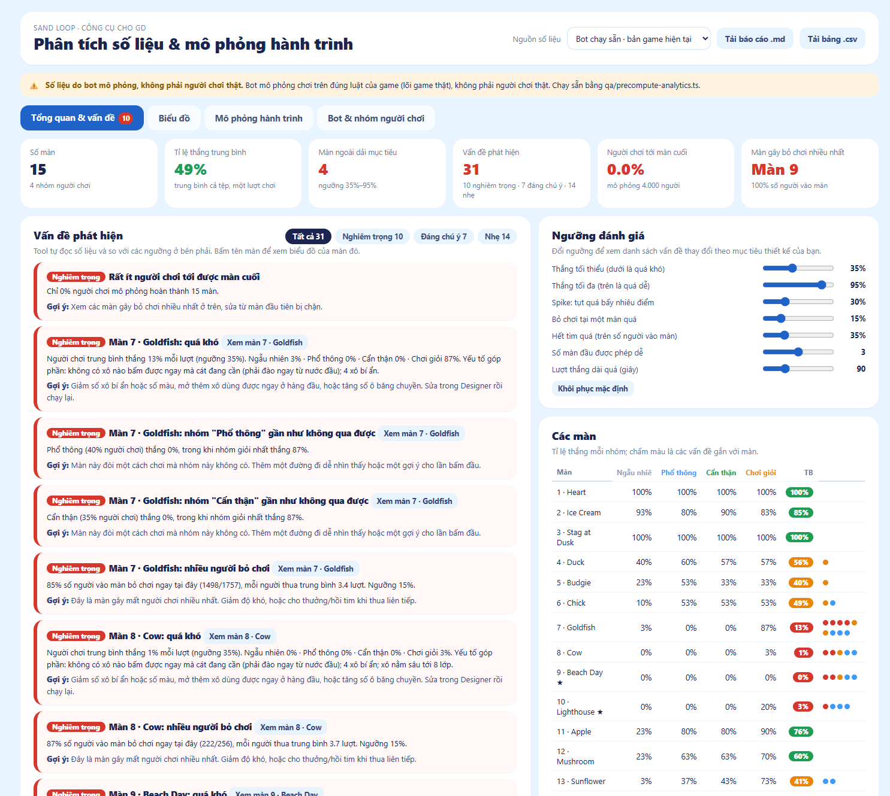

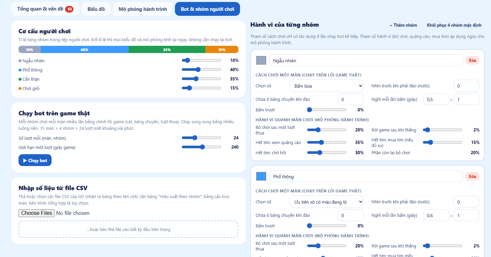

## 3.2 Tỉ lệ thắng theo màn và nhóm (bản game hiện tại, 30 lượt mỗi ô)

| Màn | Tên | Xô | Màu | Xô `?` | Ngẫu nhiên | Phổ thông | Cẩn thận | Lập kế hoạch |
|---:|---|---:|---:|---:|---:|---:|---:|---:|
| 1 | Heart | 5 | 2 | 0 | 100% | 100% | 100% | 100% |
| 2 | Ice Cream | 9 | 3 | 0 | 93% | 80% | 90% | 83% |
| 3 | Stag at Dusk | 12 | 3 | 0 | 100% | 100% | 100% | 100% |
| 4 | Duck | 16 | 4 | 1 | 40% | 60% | 57% | 57% |
| 5 | Budgie | 19 | 4 | 1 | 23% | 53% | 33% | 33% |
| 6 | Chick | 16 | 4 | 2 | 10% | 53% | 53% | 53% |
| **7** | **Goldfish** | 19 | 4 | 4 | **3%** | **0%** | **0%** | **87%** |
| **8** | **Cow** | 17 | 4 | 4 | **0%** | **0%** | **0%** | **3%** |
| **9** | **Beach Day** (Hard) | 19 | 5 | 5 | **0%** | **0%** | **0%** | **0%** |
| **10** | **Lighthouse** (Hard) | 18 | 4 | 6 | **0%** | **0%** | **0%** | **20%** |
| 11 | Apple | 16 | 5 | 0 | 23% | 80% | 80% | 90% |
| 12 | Mushroom | 15 | 5 | 0 | 23% | 63% | 63% | 70% |
| 13 | Sunflower | 15 | 5 | 0 | 3% | 37% | 43% | 73% |
| 14 | Rocket | 17 | 5 | 0 | 73% | 60% | 67% | 77% |
| 15 | Castle (Hard) | 20 | 6 | 2 | 10% | 47% | 33% | 80% |

Các ô 7 đến 10 in đậm là nơi chỉ còn nhóm "Lập kế hoạch" thắng được, hoặc không ai thắng.

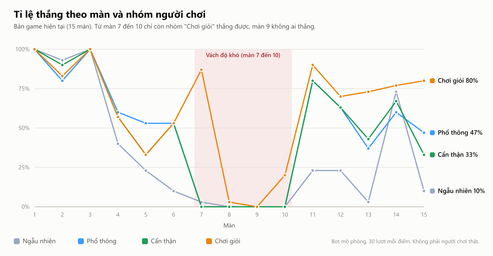

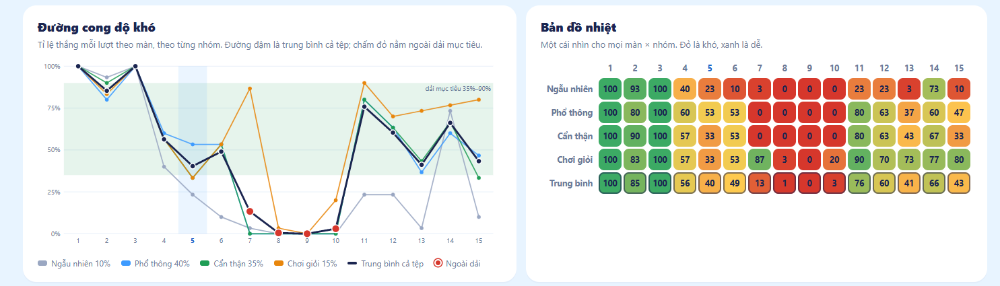

## 3.3 Các vấn đề phát hiện

### Vấn đề 1 (nghiêm trọng): vách độ khó ở màn 7 đến 10

- Tool báo **10 vấn đề nghiêm trọng**: 9 nằm ở màn 7, 8, 9, 10, và 1 vấn đề toàn cục ("rất ít người chơi tới được màn cuối").
- Màn 7: Phổ thông và Cẩn thận thắng **0%**, Chơi giỏi 87%. Lượt đầu không có xô nào bấm được lại chứa màu cát đang cần (0/4).
- Màn 8: tất cả nhóm thua gần hết (Chơi giỏi 3%). Màn 9 (Beach Day): **không nhóm nào thắng**. Màn 10: tối đa 20%.
- Đây cũng là nơi **bắt đầu dùng nhiều xô `?`** (4 đến 6 xô mỗi màn) và có 0 xô "dùng được ngay" ở màn 9: người chơi không có thông tin để quyết định.
- Mô phỏng hành trình: 4000 người chơi ảo → **0% hoàn thành**, 78,5% đã bỏ chơi sau 20 phút, **85% số người vào màn 7 bỏ chơi tại đó** (1498/1757), màn 8: 87%, màn 9: 100%. Màn 7 trở thành "tường": chỉ 259/1757 người qua được.
- **Gợi ý:** giảm xô `?` hoặc cho thêm xô lộ sẵn ở màn 7 đến 10; đặt ít nhất một xô cùng màu cát đang cần ngay hàng đầu; hoặc nới điều kiện (thêm Undo, cho Hand Pick sớm hơn); rồi kiểm tra bằng designer (câu 2) và chạy lại bot.

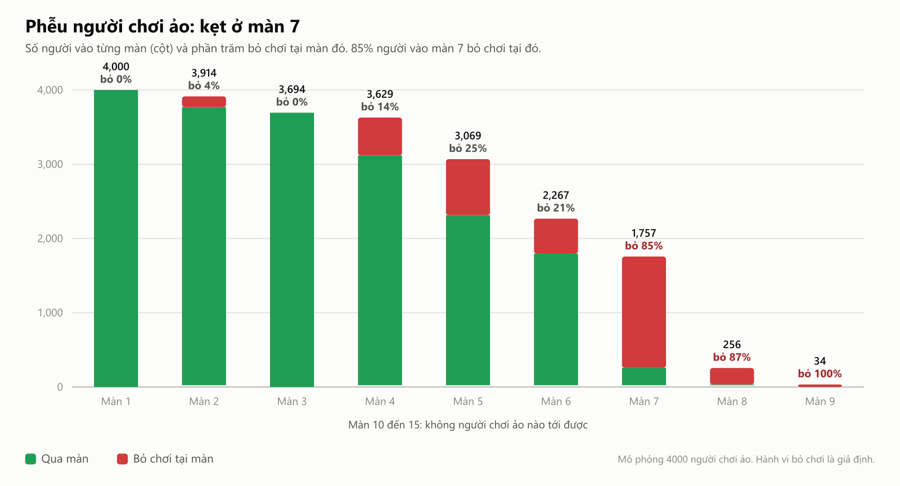

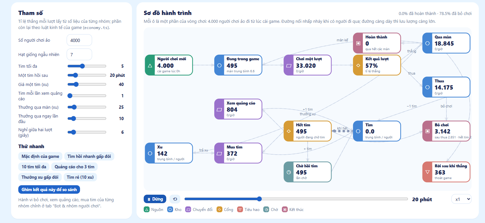

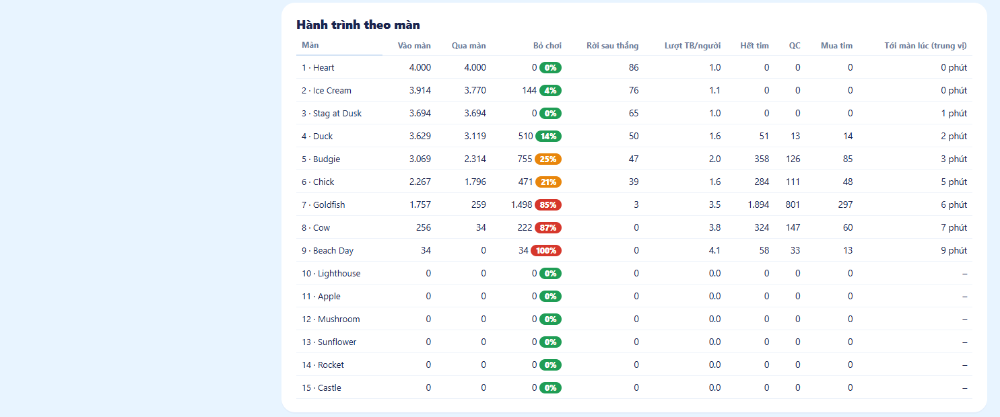

### Vấn đề 2 (đáng chú ý): spike độ khó giữa các màn liên tiếp

- Màn 3 → 4: tỉ lệ thắng trung bình tụt từ 100% xuống 56% (giảm 44 điểm); màn 6 → 7 tụt từ 49% xuống 13% (giảm 36 điểm).
- Màn 4 đến 6 vẫn có nhiều người bỏ chơi (14%, 25%, 21% số người vào màn), dù đã sửa so với bản gốc.
- Đây là chỗ chen màn trung gian hoặc hạ độ khó màn dốc.

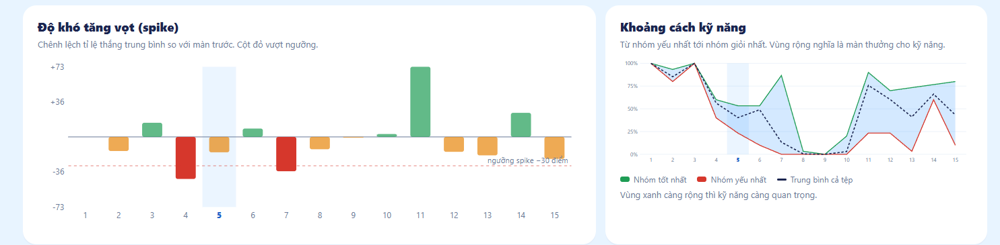

### Vấn đề 3 (đáng chú ý): hết tim và tường kinh tế ngay từ màn 7

- Màn 7: 1894 lượt hết tim trong mô phỏng (trung bình 1,1 lần mỗi người vào màn), 801 lần xem quảng cáo, 297 lần mua tim, phần còn lại chờ hoặc bỏ. Màn 8: 324 lượt, màn 9: 58 lượt.
- Kết hợp với vách ở màn 7 thì người chơi **mất hết tim ngay ở chỗ khó nhất** và chuyển hướng bỏ chơi thay vì mua tim.
- Thu nhập 15 màn chỉ khoảng 450 đến 600 xu, nơi tiêu chính là tim (40 xu/tim) và booster (100 đến 150 xu); thiết kế cũ (`gd/ECONOMY-SINK-SOURCE.md`) khuyên tường tim không nên xuất hiện trước màn 10, nhưng số liệu cho thấy tường xuất hiện từ màn 7.

### Vấn đề 4 (nhẹ): lần bấm đầu tiên hầu như sai và thua sớm không thấy tiến triển

- Màn 6: chỉ 20% số xô bấm được ngay có màu cát cần (1/5); màn 8: 0/2; màn 9: 0/5; màn 10: 0/3. Bấm theo cảm tính ở lượt đầu gần như luôn sai.
- Màn 7, 8, 9, 10: khi thua, trung bình còn 94 đến 100% lượng cát trên khung, người chơi không thấy mình tiến triển và không có động lực thử lại. **Gợi ý:** cho thấy trước gợi ý hoặc để lượt đầu "an toàn" hơn.

### Vấn đề 5 (nhẹ): chênh lệch kỹ năng quá lớn

- Màn 7: chỉ nhóm "Chơi giỏi" qua được (87%), các nhóm còn lại gần 0%. Màn 13 (Sunflower): 3% Ngẫu nhiên đến 73% Chơi giỏi. Màn có khoảng cách kỹ năng lớn kiểu này không phù hợp để tăng độ khó dần.

### Quan sát so với bộ số liệu cũ của GD (10 màn gốc, trước khi sửa)

| Màn | Số liệu GD cũ | Bản hiện tại (bot) |
|---|---|---|
| 5 (Budgie) | Tỉ lệ thắng 5,9%, **76,4% bỏ chơi** (rào cản lớn nhất) | Phổ thông 53%, bỏ chơi 25% (đã giảm, vẫn đáng chú ý) |
| 9 (Beach Day) | Tỉ lệ thắng 59,5%, bỏ chơi 12,8% | **0% mọi nhóm trừ Chơi giỏi** |

Hai bộ số liệu **không so trực tiếp được** vì cách mô hình hóa người chơi khác nhau (bộ GD là mô phỏng tổng hợp, bộ hiện tại là bot chơi trên lõi game thật). Điểm cần ghi nhận: cả hai đều chỉ ra cụm màn 4 đến 10 là nơi người chơi rời game, và khả năng đó chưa giải quyết ở màn 7 đến 10.

## 3.4 Giới hạn của phân tích (cần nói rõ)

1. **Bot không phải người thật.** Persona là heuristic, không đơn điệu theo kỹ năng (ví dụ màn 5 "Chơi giỏi" kém "Phổ thông").
2. **Kết quả "không ai thắng" là về bot, không phải bằng chứng màn vô nghiệm.** Người dùng đã tự thắng cả 10 màn gốc, và nhóm "Chơi giỏi" thắng màn 7 ở mức 87%. Nghĩa là các màn 7 đến 10 thắng được nhưng cần chiến lược mà bot thường không có.
3. Thử cho bot "theo lời giải của solver" (fast và real) và chính sách chọn xô nhỏ nhất đều thua vì bẫy và độ lệch mô hình nên đã bỏ; vẫn giữ policy `smallest` làm tùy chọn.
4. Hành vi tim, quảng cáo, mua tim, bỏ chơi là **giả định chỉnh được**, không đo. Hazard bỏ chơi lấy khoảng 20% mỗi lượt thua và 2% mỗi lượt thắng.
5. Mỗi ô chỉ 30 lượt nên sai số lớn (±10 đến 18 điểm phần trăm).

## 3.5 Khuyến nghị tiếp theo

| Ưu tiên | Việc | Cách kiểm tra |
|---|---|---|
| 1 | Chơi thử màn 7 đến 10 với 5 đến 10 người thật, ghi số lần thử và nơi bỏ chơi | So với bảng 3.2 để chỉnh persona bot |
| 2 | Hạ độ khó màn 7 đến 10: giảm xô `?`, đặt xô cần ngay ở hàng đầu | `designer.html` sinh lại bố cục rồi chạy lại `analytics.html` |
| 3 | Dời tường tim sau màn 10 hoặc tặng tim/booster ở màn 7 | Tab Mô phỏng hành trình, nhìn "Hết tim" và "Bỏ chơi" |
| 4 | Thêm điểm tiêu xu và thưởng theo mốc (xem `gd/ECONOMY-SINK-SOURCE.md` mục 4.3) | Mô phỏng thu - chi sau 15 màn |
| 5 | Thu thập log thật (xu kiếm/tiêu theo ngày, màn hết tim, tỉ lệ mua tim) | Nhập CSV vào tab "Bot & nhóm" |

---

# Phụ lục

## A. Cách chạy lại

```
npm install
npm run build                 # game: dist/index.html
npm run designer              # tool xếp level: dist-designer/designer.html
npm run analytics             # tool phân tích: dist-analytics/analytics.html

npx tsx qa/precompute-analytics.ts part <màn>   # rồi merge: sinh lại baseline.json
npx tsx qa/gen-test.ts <arts> <tags> <ms>       # đo gen màn
node --import tsx qa/core-audit.ts              # audit lõi game
node qa/analytics-smoke.mjs [--bots]            # smoke test analytics (Chrome có cửa sổ)
```

## B. Bản đồ file

| Mục | File |
|---|---|
| Game | `src/core`, `src/render`, `src/ui`, `src/app`, `dist/index.html` |
| Báo cáo kiểm thử gốc | `qa/BAO-CAO-KIEM-THU.md`, `qa/results/*.json|png` |
| Danh sách vấn đề | `../Danh-sach-van-de-Sandloop-v4.xlsx` |
| Cơ chế mới và kinh tế | `gd/CO-CHE-MOI.md`, `gd/ECONOMY-SINK-SOURCE.md` |
| Tool xếp level | `designer.html`, `src/designer/*` |
| Tool phân tích | `analytics.html`, `src/analytics/*`, `src/analytics/baseline.json` |
| Số liệu GD | `gd/csv/*`, `gd/du-lieu-gd.xlsx` |
